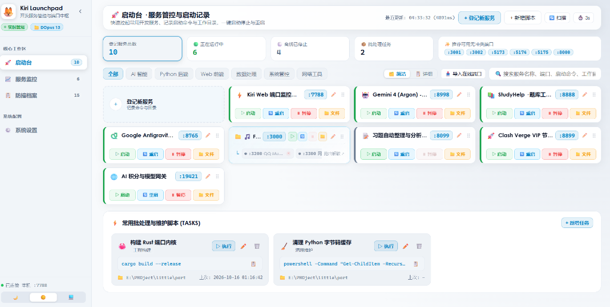

<h4 align="right"><strong><a href="./README.md">English</a></strong> | <a href="./README_CN.md">简体中文</a></h4>

<p align="center">
  <picture>
    <source media="(prefers-color-scheme: dark)" srcset="assets/kiri-wordmark-dark.svg">
    <source media="(prefers-color-scheme: light)" srcset="assets/kiri-wordmark-light.svg">
    
  </picture>
</p>

<h3 align="center"><nobr>🦊 Kiri Launchpad · Development Service Hub & Ultra-Fast Port Monitor (Web + CLI)</nobr></h3>

<p align="center">
  A modern, high-performance local development service launchpad, visual port control center, and conflict-prevention hub. Features one-click service startup/restart/stop, folder card bundling, physical file mode navigation, and millisecond-level port monitoring.
</p>

---

<p align="center">
  
  
  
  
</p>

<p align="center">
  
</p>

---

## ✨ Key Features

### 1. 🚀 Service Launchpad & Command Registry
- **Compact 4-Column Grid**: High information density with crisp Century Gothic typography, designed strictly to prevent horizontal overflow;
- **Integrated High-Frequency Actions**:
  - `▷ Start`: Runs configured startup command in an independent console, and **automatically launches default browser** once the port is listening;
  - `🔄 Restart`: Gracefully terminates old instance, starts fresh process, and re-opens browser;
  - `⏸ Stop`: One-click process termination (`taskkill` / `kill`);
  - `📁 Folder`: Jump directly to physical disk location via **"File Mode"**.
- **📁 Folder Cards (Service Grouping)**:
  - Drag and hold a card for 400ms over another to bundle into a folder card;
  - Sub-services rendered in row 2 as sleek **status pills (`:3200`, `:3300`)** with live health indicators (🟢/⚪);
  - **Drag-Out to Ungroup**: Drag any child port pill outside the card to instantly ungroup back into an independent card. Or click `×` to remove.

### 2. 📂 Physical "File Mode" (Directory Opus First-Class Integration)
- **Target Selection Invariant**: Clicking "Folder" doesn't just open a parent directory; it actively launches the file manager and **highlights/selects the exact target project folder**;
- **Directory Opus Priority**: Prioritizes `dopusrt.exe` on `WinSta0\Default` physical station for instant foreground popups; falls back cleanly to Windows Explorer.

### 3. 📈 Real-Time Service Monitor
- **~70ms Kernel Engine**: Pure Win32 PEB inspection and TCP socket matching;
- **Comprehensive Metrics**: Listening port, process name, PID, WorkingSet memory, detected framework (Vite, FastAPI, Python, Node, etc.), uptime, and status;
- **📡 Event Stream**: Live streaming log of `STARTED` and `STOPPED` events;
- **💻 Native CLI Terminal View**: Built-in ASCII table and colored log following.

### 4. 📋 Port Anti-Collision Registry & Suggested Ports
- **Lifecycle Port Ledger**: Automatically records every port ever allocated locally, with custom alias editing;
- **✨ Smart Conflict-Free Recommendations**: Recommends safe, unassigned consecutive ports.

### 5. ⚡ Batch & Maintenance Tasks
- Quick-access task runner for build scripts (`cargo build --release`), cache purges, and automated routines with real-time execution feedback.

---

## ⚡ Quick Start

### Option 1: One-Click Windows Launch (Recommended)
Double-click the batch file in the repository root:
```bash
双击打开Kiri.bat
```
Automatically launches the lightweight backend daemon and opens your browser:
👉 **http://127.0.0.1:7788/**

### Option 2: Python Backend
```bash
# Start Web daemon
python kiri_web.py

# Headless / daemon mode (no browser popup)
python kiri_web.py --no-browser
```

### Option 3: Rust Native CLI Mode
If you prefer running directly in the terminal:
```bash
cargo run --release -- ports
# Or if installed globally
ports
ports logs <port|pid> -f
```

---

## 🏗️ Project Architecture

```text
├── web/
│   └── index.html               # Modern Kiri Launchpad Web Frontend (Century Gothic standard typography)
├── kiri_web.py                  # High-performance Win32 port monitor & Launchpad server (~70ms loop)
├── 双击打开Kiri.bat             # Windows one-click launcher
├── kiri_services.template.json  # Sanitized service seed template
├── src/                         # Kiri Native Rust CLI Source Code
│   ├── main.rs
│   ├── platform/                # Windows / macOS / Linux PEB & CWD collectors
│   └── render/                  # ANSI terminal formatter
├── Cargo.toml                   # Rust crate configuration
└── AGENTS.md                    # Engineering standards & File Mode protocol
```

---

## 🔒 Privacy & Sanitization

This project strictly adheres to open-source privacy standards:
- Local runtime databases (`kiri_services.json`, `port_aliases.json`) are completely excluded via `.gitignore`;
- Zero personal machine paths, credentials, or private project directories committed.

---

## 📄 License

Apache-2.0 License © 2026 Kekeyo & Kiri Contributors.
